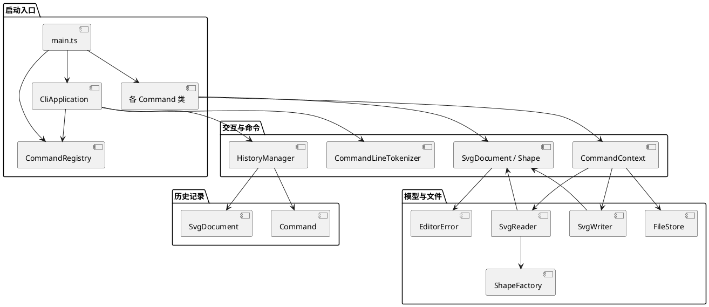

Git 仓库：[Epiphany2003/lab1-phase1-svg-editor](https://github.com/Epiphany2003/lab1-phase1-svg-editor)

# 架构方案

## 模块划分

| 模块 | 目录 | 职责 |
|---|---|---|
| 终端交互 | `src/cli/` | 逐行读取输入、切分带引号参数、格式化结构树；不直接修改图形对象。 |
| 命令 | `src/command/` | 每个命令一个类，负责参数校验、调用领域操作并生成单行结果。`CommandRegistry` 按命令名定位命令。 |
| 图形模型 | `src/model/` | 封装画布、图形属性、父子关系、移动、缩放、分组、层级顺序和克隆。 |
| 文件读写 | `src/io/` | 用 `SvgReader` 导入支持的 SVG 子集，用 `SvgWriter` 输出 XML，由 `FileStore` 处理本地文件。 |
| 历史记录 | `src/history/` | 管理编辑命令的撤销、重做和文档类命令的历史边界。 |
| 通用错误 | `src/core/` | 提供统一领域错误，供命令边界转换成 `error:` 输出。 |
| 自动化验证 | `test/` | 覆盖命令解析、图形组合、撤销重做、错误原子性及 SVG 读写。 |

## 设计模式的选择

- **Command**：每条 CLI 命令都有独立类并实现 `Command`。`CommandRegistry` 只负责“命令名到命令对象”的映射；`CliApplication` 根据命令声明的变更类型决定是否进入历史记录。
- **Composite**：`SvgDocument` 与 `Group` 都是 `ShapeContainer`。`Group` 子图形继续是 `Shape`，因此 `move`、`scale`、`delete`、`set`、`front` 和 `back` 通过同一图形接口操作叶子和容器。
- **Factory**：`ShapeFactory` 创建 CLI 图形并把外部 SVG 元素转换为对应类。命令名分派只在 `CommandRegistry`，图形类型分派只在 `ShapeFactory`；后续可将两处替换为注册机制。
- **撤销重做**：每个编辑命令在克隆的文档上执行，成功后保存执行前后快照。失败时丢弃工作副本，因而命令失败不改变文档；新编辑会清空 redo 栈。`init`、`read`、`save` 和 `canvas` 尺寸修改清空历史并建立 I/O 边界。

本阶段内置 `rect`、`circle`、`ellipse`、`line`、`text`、`g`。`box` 留作插件阶段的类型，本实现按规格返回 `unknown shape type`。插件阶段可通过 `ShapeProvider` 描述创建参数、子部件和属性传播。

## 依赖方向规则

1. `model` 可以依赖 `core` 的错误类型；模型不依赖 CLI、命令、历史记录或文件系统。
2. `io` 可以依赖 `model` 创建和序列化图形；模型不依赖 `io`。
3. `command` 可以依赖 `model`、`io` 服务和 `CommandContext`；模型不得反向依赖具体命令。
4. `history` 可以依赖 `Command` 契约、上下文和文档快照；命令不直接操作历史栈。
5. `cli` 负责连接解析器、注册表、命令上下文和历史记录；`main.ts` 是唯一组装所有具体命令的入口。
6. `test` 可以依赖以上模块；生产代码不依赖测试目录。

代码中，`SvgReader` 和 `SvgWriter` 使用图形模型；模型层不引用文件读写，具体命令也不引用终端交互层。

## 变化点假设

| 可能变化的部分 | 当前处理 |
|---|---|
| 新图形类型及复合图形插件 | 集中在 `ShapeFactory` 创建；插件阶段可改为提供者注册。现在不实现 `box`，避免内核提前依赖未来插件。 |
| CLI 语法和参数规则 | 每个命令独立处理参数，词法切分集中在 `CommandLineTokenizer`。增加语法不需要在图形模型里增加命令名分支。 |
| SVG 格式和读写策略 | `SvgReader`、`SvgWriter`、`FileStore` 分开。当前只承诺题目要求的六类元素；不支持的 SVG 元素会报错，避免静默丢图。 |
| 撤销存储方式 | 当前用整文档快照，易于保证组合编辑的一条命令一条历史记录。若文档变大，再依据实测成本改为命令逆操作或差量记录。 |

# 过程记录

1. 先完成图形类和 `Group`，再由命令类调用模型操作。撤销重做采用文档快照，便于让分组、删除等组合编辑保持为一个历史单元。
2. 按两节点流程图回放检查 `create ... in`、容器移动、属性修改和 SVG 保存读回。
3. 测试时发现顶层容器不能解散；用例据此改为验证嵌套容器可解散、顶层容器返回规定错误。

# 一致性自查

1. **模块划分**：实际目录与方案一致，生产代码位于 `src/` 的六个模块中，测试位于 `test/`。
2. **依赖方向**：模型不依赖命令或文件读写；SVG I/O 使用模型；命令通过上下文调用领域对象和文件服务；CLI 负责组装命令。

# 质量保证手段

- `npm run typecheck` 使用严格 TypeScript 配置检查类型。
- `npm test` 的 13 项断言覆盖引号及 Windows 路径解析、六类图形创建、容器递归移动缩放、分组与解散、z-order、undo/redo、redo 清空、I/O 历史边界、失败命令无副作用、SVG 往返、缺失 id 自动分配、重复 id 与不支持元素报错。
- 按两节点流程图示例运行 CLI，执行移动、撤销、重做、保存、读回和树输出。
- `npm run cli` 启动交互 REPL，提示符为 `svg>`；把命令写入文本文件后可通过标准输入回放。
